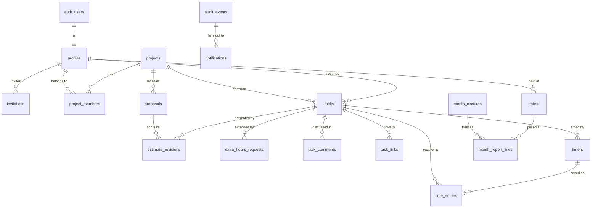

# Olifant Workboard — Database Schema

Target: Supabase Postgres **17**. The migrations that create everything below live in
`supabase/migrations/` (`0001`–`0015`). Product rules come from [PRD.md](./PRD.md); the
surrounding architecture is in [Tech.md](./Tech.md).

The migrations are not a sketch. Migrations `0001`–`0010` were first applied to a clean
Postgres database with a small stand-in for Supabase's `auth` schema and roles, and three
scenario scripts ran 105 checks against them. Those checks cover access isolation
(including after a task changes hands), the estimate and approval flow, counting time
against limits (including the PRD §5.4 example), timer splits at midnight and across the
October daylight-saving change, automatic timer stops, closing and reopening a month,
notifications and their payloads, the email outbox, archived projects, and deactivation.
An independent review of these documents against the SQL found sixteen issues; all are
fixed and the third script checks them. The scripts are now the pgTAP tests in
`supabase/tests/` (section 12), which run on a real Supabase project and add isolation
checks for every table and view. `0011` (the email retry job) needs `pg_cron` and Vault
secrets, so it is applied to the development and production projects only.

## 1. Conventions

- Lowercase `snake_case` for every identifier, so nothing ever needs quoting.
- `uuid` primary keys from `gen_random_uuid()`. The exception is `audit_events`, which
  uses `bigint generated always as identity`: it is the largest table, its order matters,
  and its ids never appear in URLs.
- `text` with a `check` constraint instead of Postgres enums, so adding a value later is a
  constraint change rather than a type migration.
- **Durations are whole minutes** in `integer` columns named `*_minutes`. Estimates and
  extra hours are multiples of 15 (`% 15 = 0`); tracked time is any whole minute.
- **Money** is `numeric(10,2)` for hourly rates and `numeric(14,2)` for amounts. Amounts
  are rounded to cents once per report line.
- `timestamptz` for moments, `date` for work dates. A work date is always a date in the
  organization's time zone (`organization_settings.time_zone`), computed in the database
  by `app.local_date()` and `app.org_today()`, never by the server or the browser.
- Every foreign key has an index.
- Two schemas: `public` holds the tables, views, and the command functions the app calls;
  `app` holds helpers and trigger functions. Only `public` is exposed through the Data
  API, so nothing in `app` can be called over HTTP.

## 2. How access works

This is the one structural difference from the Invoice Generator, and everything else
follows from it.

**Reads go through row-level security.** Every table has RLS enabled and SELECT policies
only. Server Components read tables and views with the signed-in person's session, and
Postgres returns only the rows that person may see.

**Writes go through command functions.** The `authenticated` role has no INSERT, UPDATE, or
DELETE privilege on any table. Every change is a call to a function such as
`submit_proposal()` or `stop_timer()` (section 6). Each command:

1. resolves the caller with `app.require_active()` or `app.require_admin()`;
2. locks the rows it changes and checks every PRD rule that applies (status, ownership,
   dates, limits, self-approval);
3. makes the change;
4. writes one or more history events with `app.log_event()`, which in turn creates the
   notifications (section 5.6).

Commands are `security definer` with `set search_path = ''`, because they must do things
the caller may not do directly: write history, notify other people, recount time, freeze
a month. The cost of definer functions is that authorization lives in their code, so the
pattern is fixed and the database tests exercise it: every command starts with
`require_active()`/`require_admin()`, and every task lookup goes through `app.lock_task()`,
which answers `task_not_found` for a task the caller cannot see and `project_archived` for
anything in an archived project.

This shape gives three guarantees the PRD asks for. The rules cannot be bypassed with a
direct API call, because there is no direct write path. History is written by the database
in the same transaction as the change it describes. And a state machine as rich as this
one (PRD §5.1) lives in one place instead of being spread across policies, triggers, and
server code.

**Who the caller is.** Policies and commands identify the caller with `app.viewer_id()`
rather than `auth.uid()`. It returns the caller's id only while their profile is active,
so a deactivated person's still-valid session reaches nothing, immediately.

```sql
create or replace function app.viewer_id()
returns uuid
language sql
stable
security definer
set search_path = ''
as $$
  select p.id
    from public.profiles p
   where p.id = (select auth.uid())
     and p.status = 'active';
$$;
```

```sql
create or replace function app.is_admin()
returns boolean
language sql
stable
security definer
set search_path = ''
as $$
  select exists (
    select 1
      from public.profiles p
     where p.id = (select auth.uid())
       and p.status = 'active'
       and p.role = 'admin'
  );
$$;
```

## 3. Entity relationships



`organization_settings` is a single row. `audit_events` references tasks, projects, and
people by plain id columns rather than foreign keys, so history can never block or be
changed by anything else (a deleted draft task keeps its history).

## 4. Tables

### 4.1 `organization_settings`

```sql
create table public.organization_settings (
  id                smallint     primary key default 1 check (id = 1),
  name              text         not null default 'Olifant Digital'
                      check (length(btrim(name)) between 1 and 120),
  time_zone         text         not null default 'Europe/Budapest',
  tolerance_percent numeric(5,2) not null default 10
                      check (tolerance_percent >= 0 and tolerance_percent <= 100),
  default_currency  text         not null default 'EUR'
                      check (default_currency in ('EUR', 'USD')),
  updated_at        timestamptz  not null default now()
);

create trigger organization_settings_set_updated_at
  before update on public.organization_settings
  for each row execute function app.tg_set_updated_at();
```

Exactly one row (`id = 1`). Everyone signed in can read it, because the time zone and the
tolerance shape what every screen shows. Changing the time zone is validated against
`pg_timezone_names` in `update_settings()`; changing the tolerance recounts every task that
has time in an open month.

### 4.2 `profiles`

```sql
create table public.profiles (
  id             uuid        primary key references auth.users (id) on delete restrict,
  full_name      text        not null check (length(btrim(full_name)) between 1 and 120),
  email          text        not null,
  role           text        not null check (role in ('admin', 'freelancer')),
  status         text        not null default 'active'
                   check (status in ('active', 'deactivated')),
  deactivated_at timestamptz,
  avatar_path    text,
  created_at     timestamptz not null default now(),
  updated_at     timestamptz not null default now(),

  constraint profiles_deactivated_has_time
    check ((status = 'deactivated') = (deactivated_at is not null)),
  constraint profiles_avatar_path_check
    check (
      avatar_path is null
      or avatar_path = id::text || '/avatar.jpg'
      or avatar_path = id::text || '/avatar.png'
      or avatar_path = id::text || '/avatar.webp'
    )
);

create unique index profiles_email_key on public.profiles (lower(email));
create index profiles_role_status_idx on public.profiles (role, status);

create trigger profiles_set_updated_at
  before update on public.profiles
  for each row execute function app.tg_set_updated_at();
```

One row per person who accepted an invitation, created by the trigger in section 5.1.
`on delete restrict` against `auth.users` means a person can never be deleted once they
exist; they are deactivated instead (PRD rule 18). `avatar_path` is null until the person
uploads a photo (PRD §6.14). The file itself is the object at that path in the private
Storage bucket `avatars` (2 MB; JPEG, PNG, or WebP). Storage policies let a person read
and replace only their own object, and let an Admin read every object. `set_my_avatar`
is the only way the column changes. The role is either `admin` or
`freelancer`; the postponed project manager role will be a value of
`project_members.role`, not of this column.

### 4.3 `invitations`

```sql
create table public.invitations (
  id               uuid        primary key default gen_random_uuid(),
  email            text        not null check (email ~* '^[^@\s]+@[^@\s]+\.[^@\s]+$'),
  full_name        text        not null check (length(btrim(full_name)) between 1 and 120),
  role             text        not null check (role in ('admin', 'freelancer')),
  token_hash       text        not null unique,       -- sha256 of the emailed token, hex
  expires_at       timestamptz not null,
  invited_by       uuid        references public.profiles (id),  -- null only for the bootstrap admin
  accepted_at      timestamptz,
  accepted_user_id uuid        references public.profiles (id),
  revoked_at       timestamptz,
  last_sent_at     timestamptz not null default now(),
  send_count       integer     not null default 1 check (send_count > 0),
  last_send_error  text,
  created_at       timestamptz not null default now(),

  constraint invitations_one_outcome
    check (not (accepted_at is not null and revoked_at is not null)),
  constraint invitations_accepted_has_user
    check ((accepted_at is null) = (accepted_user_id is null))
);

create unique index invitations_pending_email_key
  on public.invitations (lower(email))
  where accepted_at is null and revoked_at is null;
create index invitations_invited_by_idx on public.invitations (invited_by);
create index invitations_accepted_user_idx on public.invitations (accepted_user_id);
```

The only way into the application. The server generates a random token, emails it, and
stores only its sha256 hash. A link is valid for seven days; renewing replaces the token.
`invited_by` is null only for the very first Admin, created by the bootstrap script
(Tech.md §5.3). The partial unique index allows one pending invitation per address.

### 4.4 `projects` and `project_members`

```sql
create table public.projects (
  id                uuid        primary key default gen_random_uuid(),
  name              text        not null check (length(btrim(name)) between 1 and 120),
  description       text        not null default '',
  status            text        not null default 'active'
                      check (status in ('active', 'on_hold', 'archived')),
  status_changed_at timestamptz not null default now(),
  created_by        uuid        not null references public.profiles (id),
  created_at        timestamptz not null default now(),
  updated_at        timestamptz not null default now()
);

create index projects_status_idx on public.projects (status);
create index projects_created_by_idx on public.projects (created_by);

create trigger projects_set_updated_at
  before update on public.projects
  for each row execute function app.tg_set_updated_at();
```

```sql
create table public.project_members (
  project_id uuid        not null references public.projects (id) on delete restrict,
  user_id    uuid        not null references public.profiles (id) on delete restrict,
  role       text        not null default 'member' check (role in ('member')),
  added_by   uuid        not null references public.profiles (id),
  added_at   timestamptz not null default now(),

  primary key (project_id, user_id)
);

create index project_members_user_idx on public.project_members (user_id);
create index project_members_added_by_idx on public.project_members (added_by);
```

Membership is what lets a freelancer create tasks in a project and see it in their list.
Removing a member deletes the row (the history keeps the event) and is refused while they
are the assignee of any task in the project that is not final. `role` has the single
value `member` today; `manager` is reserved for the project manager role postponed in
PRD §3.

### 4.5 `tasks`

```sql
create table public.tasks (
  id                   uuid        primary key default gen_random_uuid(),
  project_id           uuid        not null references public.projects (id) on delete restrict,
  title                text        not null check (length(btrim(title)) between 1 and 200),
  description          text        not null default '',
  status               text        not null default 'draft' check (status in (
                         'draft', 'pending_approval', 'changes_requested', 'approved',
                         'in_progress', 'on_hold', 'done', 'accepted', 'rejected', 'cancelled')),

  assignee_id          uuid        references public.profiles (id),
  assigned_at          timestamptz,                -- start of the assignee's visible history
  created_by           uuid        not null references public.profiles (id),

  -- working estimate, edited by the assignee while Draft or Changes requested
  estimate_min_minutes integer     check (estimate_min_minutes > 0 and estimate_min_minutes % 15 = 0),
  estimate_max_minutes integer     check (estimate_max_minutes > 0 and estimate_max_minutes % 15 = 0),
  estimate_note        text,

  -- set by approval
  approved_revision_id uuid,                       -- FK added below
  first_approved_at    timestamptz,
  first_approved_on    date,                       -- org-local; earliest allowed work date
  limit_minutes        integer     check (limit_minutes > 0),

  -- maintained by app.recount_task()
  counted_minutes      integer     not null default 0 check (counted_minutes >= 0),
  over_limit_minutes   integer     not null default 0 check (over_limit_minutes >= 0),

  ever_submitted       boolean     not null default false,
  status_changed_at    timestamptz not null default now(),
  created_at           timestamptz not null default now(),
  updated_at           timestamptz not null default now(),

  constraint tasks_estimate_order check (
    estimate_min_minutes is null or estimate_max_minutes is null
    or estimate_min_minutes <= estimate_max_minutes),
  constraint tasks_assignment_pair check ((assignee_id is null) = (assigned_at is null)),
  constraint tasks_needs_assignee check (status = 'draft' or assignee_id is not null),
  constraint tasks_working_states_have_limit check (
    status not in ('approved', 'in_progress', 'on_hold', 'done', 'accepted')
    or (limit_minutes is not null and approved_revision_id is not null and first_approved_on is not null))
);

create index tasks_project_status_idx on public.tasks (project_id, status);
create index tasks_assignee_status_idx on public.tasks (assignee_id, status);
create index tasks_created_by_idx on public.tasks (created_by);
create index tasks_waiting_idx on public.tasks (status_changed_at)
  where status in ('pending_approval', 'done');
alter table public.tasks
  add constraint tasks_approved_revision_fk
  foreign key (approved_revision_id) references public.estimate_revisions (id);
create index tasks_approved_revision_idx on public.tasks (approved_revision_id);

create trigger tasks_set_updated_at
  before update on public.tasks
  for each row execute function app.tg_set_updated_at();
create trigger tasks_guard
  before insert or update or delete on public.tasks
  for each row execute function app.tg_tasks_guard();
```

Notes on the design:

- **Working estimate vs approved estimate.** `estimate_*` is what the assignee is editing
  while the task is Draft or Changes requested. Submitting copies it into an
  `estimate_revisions` row. Approval sets `approved_revision_id`, `limit_minutes` (the
  approved maximum), and, the first time only, `first_approved_at` and `first_approved_on`
  — the org-local date before which no time can be tracked.
- **`limit_minutes` grows** by every approved extra-hours request. The ceiling is not
  stored: it depends on the current tolerance and is computed by
  `app.ceiling_minutes(limit, tolerance)` (section 5.3) and the `task_progress` view.
- **`counted_minutes` and `over_limit_minutes`** are totals maintained by
  `app.recount_task()`, so lists and dashboards never sum entries.
- **`assigned_at`** is set by the guard trigger whenever the assignee changes. It is the
  start of what the assignee may see: comments and history from before it stay hidden from
  them (PRD §4).
- **`ever_submitted`** decides whether a task may be deleted (PRD rule 17).
- The check constraints encode that only drafts may be unassigned and that every working
  status (Approved through Accepted) has an approved estimate and a limit.

The guard trigger is the backstop for the state machine in PRD §5.1. Commands perform the
transitions; the trigger guarantees nothing else can.

```sql
create or replace function app.tg_tasks_guard()
returns trigger
language plpgsql
set search_path = ''
as $$
begin
  if tg_op = 'DELETE' then
    if old.ever_submitted then
      raise exception 'task_was_submitted' using errcode = 'check_violation';
    end if;
    return old;
  end if;

  if tg_op = 'INSERT' then
    new.assigned_at := case when new.assignee_id is null then null else now() end;
    return new;
  end if;

  if new.status is distinct from old.status then
    if (old.status, new.status) not in (
      ('draft', 'pending_approval'), ('draft', 'cancelled'),
      ('pending_approval', 'approved'), ('pending_approval', 'changes_requested'),
      ('pending_approval', 'rejected'), ('pending_approval', 'draft'),
      ('pending_approval', 'cancelled'),
      ('changes_requested', 'pending_approval'), ('changes_requested', 'draft'),
      ('changes_requested', 'cancelled'),
      ('approved', 'in_progress'), ('approved', 'on_hold'), ('approved', 'draft'),
      ('approved', 'cancelled'),
      ('in_progress', 'on_hold'), ('in_progress', 'done'), ('in_progress', 'cancelled'),
      ('in_progress', 'draft'),   -- reassign after every entry was deleted
      ('on_hold', 'approved'), ('on_hold', 'in_progress'), ('on_hold', 'cancelled'),
      ('on_hold', 'draft'),       -- reassign, only while no time exists
      ('done', 'accepted'), ('done', 'in_progress'), ('done', 'cancelled')
    ) then
      raise exception 'invalid_status_transition'
        using errcode = 'check_violation', detail = old.status || ' -> ' || new.status;
    end if;
    new.status_changed_at := now();
  end if;

  if new.assignee_id is distinct from old.assignee_id then
    new.assigned_at := case when new.assignee_id is null then null else now() end;
  end if;

  return new;
end;
$$;
```

### 4.6 `proposals` and `estimate_revisions`

```sql
create table public.proposals (
  id           uuid        primary key default gen_random_uuid(),
  project_id   uuid        not null references public.projects (id) on delete restrict,
  submitted_by uuid        not null references public.profiles (id),
  submitted_at timestamptz not null default now(),
  completed_at timestamptz                         -- set once no item is pending
);

create index proposals_open_idx on public.proposals (submitted_at) where completed_at is null;
create index proposals_submitter_idx on public.proposals (submitted_by, submitted_at desc);
create index proposals_project_idx on public.proposals (project_id);
```

```sql
create table public.estimate_revisions (
  id               uuid        primary key default gen_random_uuid(),
  task_id          uuid        not null references public.tasks (id) on delete restrict,
  proposal_id      uuid        not null references public.proposals (id) on delete restrict,
  revision_number  integer     not null check (revision_number > 0),
  min_minutes      integer     not null check (min_minutes > 0 and min_minutes % 15 = 0),
  max_minutes      integer     not null check (max_minutes > 0 and max_minutes % 15 = 0),
  note             text,
  submitted_by     uuid        not null references public.profiles (id),
  submitted_at     timestamptz not null default now(),
  decision         text        not null default 'pending' check (decision in (
                     'pending', 'approved', 'rejected', 'changes_requested', 'withdrawn')),
  decided_by       uuid        references public.profiles (id),
  decided_at       timestamptz,
  decision_comment text,

  constraint estimate_revisions_order check (min_minutes <= max_minutes),
  constraint estimate_revisions_number_key unique (task_id, revision_number),
  constraint estimate_revisions_decided check (
    (decision = 'pending') = (decided_at is null)
    and (decision = 'pending') = (decided_by is null)),
  constraint estimate_revisions_comment_required check (
    decision not in ('rejected', 'changes_requested')
    or length(btrim(coalesce(decision_comment, ''))) > 0),
  constraint estimate_revisions_no_self_decision check (
    decision in ('pending', 'withdrawn') or decided_by <> submitted_by)
);

create unique index estimate_revisions_one_pending
  on public.estimate_revisions (task_id) where decision = 'pending';
create index estimate_revisions_proposal_idx on public.estimate_revisions (proposal_id);
create index estimate_revisions_submitter_idx on public.estimate_revisions (submitted_by);
create index estimate_revisions_decider_idx on public.estimate_revisions (decided_by);
```

A proposal is the unit of approval (PRD §5.3): the items are its estimate revisions.
`completed_at` is set by the commands as soon as no item is pending. A revision is never
edited after its decision; requesting changes leads to a new revision with the next
`revision_number`. `withdrawn` covers both the assignee withdrawing an item and an Admin
reassigning or cancelling a task whose item was still pending. The partial unique index
allows one pending revision per task; the constraints require a comment on rejections and
change requests, and forbid deciding on one's own estimate.

### 4.7 `extra_hours_requests`

```sql
create table public.extra_hours_requests (
  id              uuid        primary key default gen_random_uuid(),
  task_id         uuid        not null references public.tasks (id) on delete restrict,
  requested_by    uuid        not null references public.profiles (id),
  minutes         integer     not null check (minutes > 0 and minutes % 15 = 0),
  reason          text        not null check (length(btrim(reason)) between 1 and 2000),
  status          text        not null default 'pending'
                    check (status in ('pending', 'approved', 'rejected', 'cancelled')),
  decided_by      uuid        references public.profiles (id),
  decided_at      timestamptz,
  decision_reason text,
  created_at      timestamptz not null default now(),

  constraint extra_hours_decided check ((status = 'pending') = (decided_at is null)),
  constraint extra_hours_reject_reason check (
    status <> 'rejected' or length(btrim(coalesce(decision_reason, ''))) > 0),
  constraint extra_hours_no_self_decision check (
    status in ('pending', 'cancelled') or decided_by <> requested_by)
);

create unique index extra_hours_one_pending
  on public.extra_hours_requests (task_id) where status = 'pending';
create index extra_hours_task_idx on public.extra_hours_requests (task_id);
create index extra_hours_requester_idx on public.extra_hours_requests (requested_by);
create index extra_hours_decider_idx on public.extra_hours_requests (decided_by);
```

At most one pending request per task. Approving adds `minutes` to `tasks.limit_minutes`
and recounts. Cancelling a task cancels its pending request; accepting a task is refused
while one is pending.

### 4.8 `task_comments` and `task_links`

```sql
create table public.task_comments (
  id         uuid        primary key default gen_random_uuid(),
  task_id    uuid        not null references public.tasks (id) on delete cascade,
  author_id  uuid        not null references public.profiles (id),
  kind       text        not null default 'comment' check (kind in ('comment', 'decision')),
  body       text        not null check (length(btrim(body)) between 1 and 5000),
  created_at timestamptz not null default now(),
  edited_at  timestamptz
);

create index task_comments_task_idx on public.task_comments (task_id, created_at);
create index task_comments_author_idx on public.task_comments (author_id);
```

```sql
create table public.task_links (
  id         uuid        primary key default gen_random_uuid(),
  task_id    uuid        not null references public.tasks (id) on delete cascade,
  url        text        not null check (url ~* '^https?://\S+$' and length(url) <= 2000),
  label      text        check (label is null or length(btrim(label)) between 1 and 120),
  created_by uuid        not null references public.profiles (id),
  created_at timestamptz not null default now()
);

create index task_links_task_idx on public.task_links (task_id);
create index task_links_created_by_idx on public.task_links (created_by);
```

`kind = 'decision'` marks comments written by the commands that reject, request changes,
return, or cancel; they cannot be edited or deleted. Links accept only `http`/`https`
addresses. Both cascade only from a task that was never submitted, the only kind that can
be deleted.

### 4.9 `timers`

```sql
create table public.timers (
  id          uuid        primary key default gen_random_uuid(),
  user_id     uuid        not null references public.profiles (id),
  task_id     uuid        not null references public.tasks (id) on delete restrict,
  started_at  timestamptz not null default now(),
  stopped_at  timestamptz,
  outcome     text        check (outcome in ('saved', 'discarded', 'auto_saved')),
  auto_reason text,

  constraint timers_stopped_pair check ((stopped_at is null) = (outcome is null)),
  constraint timers_order check (stopped_at is null or stopped_at >= started_at)
);

create unique index timers_one_running_per_user on public.timers (user_id) where stopped_at is null;
create index timers_task_idx on public.timers (task_id);
create index timers_user_idx on public.timers (user_id, started_at desc);
```

One row per timer run. The partial unique index is the "one running timer per person"
rule, and a paused timer still holds it (`stopped_at` is null). Stopping updates the row
instead of deleting it, which matters for Realtime: Supabase applies RLS to inserted and
updated rows it broadcasts, but not to deleted ones.

`0015` adds `paused_at` and `share_seen_at`. `paused_at` is set only while the clock is
paused. `share_seen_at` is the last heartbeat from the browser that is sharing the screen.
`timer_segments` holds each stretch of active time (`ended_at` null on the open one).
`timer_screenshots` records each capture. `storage_path` is `{user_id}/{id}.jpg` in the
private `timer-screenshots` bucket. `deleted_at` hides the row from the freelancer; the
file and the row stay visible to Admins. A freelancer reads their own segments and their
own screenshots that are not deleted. An Admin reads every row.

### 4.10 `time_entries`

```sql
create table public.time_entries (
  id                  uuid        primary key default gen_random_uuid(),
  task_id             uuid        not null references public.tasks (id) on delete restrict,
  user_id             uuid        not null references public.profiles (id),
  work_date           date        not null,
  month               date        generated always as
                        (date_trunc('month', work_date::timestamp)::date) stored,
  -- 1500, not 1440: the autumn daylight-saving day has 25 hours. The 24-hour
  -- daily cap is a command rule (app.require_daily_cap).
  duration_minutes    integer     not null check (duration_minutes between 1 and 1500),
  description         text        not null check (length(btrim(description)) between 1 and 2000),
  source              text        not null check (source in ('timer', 'manual')),
  started_at          timestamptz,
  ended_at            timestamptz,
  timer_id            uuid        references public.timers (id),
  auto_stopped_reason text,

  -- maintained by app.recount_task()
  counted_minutes     integer     not null default 0 check (counted_minutes >= 0),
  over_limit_minutes  integer     not null default 0 check (over_limit_minutes >= 0),

  created_at          timestamptz not null default now(),
  updated_at          timestamptz not null default now(),

  constraint time_entries_split check (counted_minutes + over_limit_minutes = duration_minutes),
  constraint time_entries_source_fields check (
    (source = 'timer'  and started_at is not null and ended_at > started_at)
    or (source = 'manual' and started_at is null and ended_at is null and timer_id is null))
);

create index time_entries_task_order_idx on public.time_entries (task_id, work_date, created_at, id);
create index time_entries_user_date_idx on public.time_entries (user_id, work_date);
create index time_entries_month_idx on public.time_entries (month, user_id);
create index time_entries_timer_idx on public.time_entries (timer_id);

create trigger time_entries_set_updated_at
  before update on public.time_entries
  for each row execute function app.tg_set_updated_at();
create trigger time_entries_guard
  before insert or update or delete on public.time_entries
  for each row execute function app.tg_time_entries_guard();
```

- `month` is a stored generated column, used by month locking, reports, and indexes.
- `source` records whether the entry came from the timer or was entered by hand. Timed
  entries keep `started_at`, `ended_at`, and `timer_id` for good, even after edits
  (PRD §5.5).
- `counted_minutes + over_limit_minutes = duration_minutes` always holds. A new or resized
  entry starts fully counted (guard trigger below); `app.recount_task()` then splits it.
- The 24-hour daily cap is checked by the commands (`app.require_daily_cap()`), only for
  the dates the command touched, and not by a trigger, so an automatic timer stop can
  never fail because of it and an over-long day never blocks other days. The column itself
  allows up to 1,500 minutes because the autumn daylight-saving day has 25 hours.
- The guard trigger makes every month up to and including the most recently closed one
  read-only. Months without time are never closed, so this is what stops a back-dated
  entry from landing in, say, January after February was closed.

```sql
create or replace function app.tg_time_entries_guard()
returns trigger
language plpgsql
set search_path = ''
as $$
begin
  if tg_op in ('UPDATE', 'DELETE')
     and exists (select 1 from public.month_closures c where c.month >= old.month) then
    raise exception 'month_closed' using errcode = 'check_violation';
  end if;

  if tg_op = 'DELETE' then
    return old;
  end if;

  if exists (select 1 from public.month_closures c
              where c.month >= app.month_start(new.work_date)) then
    raise exception 'month_closed' using errcode = 'check_violation';
  end if;

  if tg_op = 'INSERT' or new.duration_minutes <> old.duration_minutes then
    new.counted_minutes := new.duration_minutes;
    new.over_limit_minutes := 0;
  end if;

  return new;
end;
$$;
```

### 4.11 `rates`

```sql
create table public.rates (
  id             uuid          primary key default gen_random_uuid(),
  user_id        uuid          not null references public.profiles (id),
  hourly_rate    numeric(10,2) not null check (hourly_rate > 0),
  currency       text          not null check (currency in ('EUR', 'USD')),
  effective_from date          not null,
  created_by     uuid          not null references public.profiles (id),
  created_at     timestamptz   not null default now(),

  constraint rates_user_effective_key unique (user_id, effective_from)
);

create index rates_created_by_idx on public.rates (created_by);
```

Append-only history: a rate change is a new row with its own `effective_from`. A rate may
not take effect inside a closed month, and only rates that have not taken effect yet can
be deleted.

### 4.12 `month_closures` and `month_report_lines`

```sql
create table public.month_closures (
  month     date        primary key check (extract(day from month) = 1),
  closed_by uuid        not null references public.profiles (id),
  closed_at timestamptz not null default now()
);

create index month_closures_closed_by_idx on public.month_closures (closed_by);
```

```sql
create table public.month_report_lines (
  id                 uuid          primary key default gen_random_uuid(),
  month              date          not null references public.month_closures (month)
                                     on delete cascade deferrable initially deferred,
  user_id            uuid          not null references public.profiles (id),
  project_id         uuid          not null references public.projects (id),
  task_id            uuid          not null references public.tasks (id),
  project_name       text          not null,      -- frozen labels
  task_title         text          not null,
  rate_id            uuid          references public.rates (id),
  hourly_rate        numeric(10,2),
  currency           text          check (currency in ('EUR', 'USD')),
  counted_minutes    integer       not null check (counted_minutes >= 0),
  over_limit_minutes integer       not null check (over_limit_minutes >= 0),
  amount             numeric(14,2) not null default 0,

  constraint month_report_lines_priced check (
    counted_minutes = 0 or (rate_id is not null and hourly_rate is not null and currency is not null))
);

create index month_report_lines_month_user_idx on public.month_report_lines (month, user_id);
create index month_report_lines_user_idx on public.month_report_lines (user_id);
create index month_report_lines_project_idx on public.month_report_lines (project_id);
create index month_report_lines_task_idx on public.month_report_lines (task_id);
create index month_report_lines_rate_idx on public.month_report_lines (rate_id);
```

A month is closed when its row exists in `month_closures`. Closing writes one frozen line
per freelancer, task, and rate, with the project and task names copied in, so renaming a
task later changes nothing in a closed month. The foreign key is deferred so the lines can
be written before the closure row in the same transaction (section 5.5). Reopening deletes
the closure row and the lines cascade.

### 4.13 `audit_events`

```sql
create table public.audit_events (
  id              bigint      generated always as identity primary key,
  occurred_at     timestamptz not null default now(),
  txid            bigint      not null default (pg_current_xact_id()::text::bigint),
  actor_id        uuid        references public.profiles (id),   -- null = system
  event_type      text        not null,
  project_id      uuid,
  task_id         uuid,
  subject_user_id uuid,       -- the freelancer the event is about
  entity_id       uuid,
  data            jsonb       not null default '{}'::jsonb
);

create index audit_events_occurred_idx on public.audit_events (occurred_at desc);
create index audit_events_task_idx on public.audit_events (task_id, occurred_at) where task_id is not null;
create index audit_events_project_idx on public.audit_events (project_id, occurred_at desc) where project_id is not null;
create index audit_events_actor_idx on public.audit_events (actor_id, occurred_at desc);
create index audit_events_subject_idx on public.audit_events (subject_user_id, occurred_at desc);
create index audit_events_type_idx on public.audit_events (event_type, occurred_at desc);

create trigger audit_events_no_update_delete
  before update or delete on public.audit_events
  for each row execute function app.tg_audit_events_immutable();
create trigger audit_events_no_truncate
  before truncate on public.audit_events
  for each statement execute function app.tg_audit_events_immutable();
create trigger audit_events_fanout
  after insert on public.audit_events
  for each row execute function app.tg_audit_fanout();
```

Append-only. `txid` is the id of the transaction that wrote the event, so every event
produced by one action shares it — the email dispatcher sends one email per recipient per
action from it. `subject_user_id` is the freelancer an event is about (the assignee, the
person whose rate changed). `actor_id` is null for system events: the limit events written
by the recount are logged that way, so the assignee is notified even when their own entry
crossed the line. The triggers below make the table immutable even for the
service role; only someone able to drop the trigger could change history, which is why
history is described as tamper-evident rather than tamper-proof.

```sql
create or replace function app.tg_audit_events_immutable()
returns trigger
language plpgsql
set search_path = ''
as $$
begin
  raise exception 'audit_events_are_append_only' using errcode = 'check_violation';
end;
$$;
```

```sql
create or replace function app.log_event(
  p_event_type      text,
  p_task_id         uuid,
  p_project_id      uuid,
  p_subject_user_id uuid,
  p_entity_id       uuid,
  p_data            jsonb default '{}'::jsonb,
  p_as_system       boolean default false     -- true: no actor, so nobody is skipped
)
returns bigint
language plpgsql
security definer
set search_path = ''
as $$
declare
  v_id bigint;
begin
  insert into public.audit_events
    (actor_id, event_type, project_id, task_id, subject_user_id, entity_id, data)
  values
    (case when p_as_system then null else (select auth.uid()) end,
     p_event_type, p_project_id, p_task_id, p_subject_user_id,
     p_entity_id, coalesce(p_data, '{}'::jsonb))
  returning id into v_id;
  return v_id;
end;
$$;
```

### 4.14 `notifications`

```sql
create table public.notifications (
  id               uuid        primary key default gen_random_uuid(),
  recipient_id     uuid        not null references public.profiles (id),
  event_id         bigint      not null references public.audit_events (id),
  type             text        not null,
  task_id          uuid,
  project_id       uuid,
  txid             bigint      not null,      -- one email per recipient per action
  data             jsonb       not null default '{}'::jsonb,  -- recipient-safe copy of the event data
  read_at          timestamptz,
  email_status     text        not null default 'none'
                     check (email_status in ('none', 'pending', 'sending', 'sent', 'failed')),
  email_attempts   integer     not null default 0,
  email_claimed_at timestamptz,
  email_sent_at    timestamptz,
  email_last_error text,
  created_at       timestamptz not null default now()
);

create index notifications_recipient_idx on public.notifications (recipient_id, created_at desc);
create index notifications_unread_idx on public.notifications (recipient_id) where read_at is null;
create index notifications_outbox_idx on public.notifications (created_at)
  where email_status in ('pending', 'sending', 'failed');
create index notifications_event_idx on public.notifications (event_id);
```

One row per recipient per event: the in-app list and the email outbox in one table.
`email_status` moves `none` (in-app only) or `pending` → `sending` → `sent` / `failed`.
Rows are created only by the fan-out trigger (section 5.6). `data` is a copy of the event's
data with anything about other freelancers removed, so the bell can say which month was
closed or that a project went on hold without the freelancer reading the history table.

## 5. Functions and triggers

### 5.1 Profile creation from an invitation

```sql
create or replace function app.handle_new_user()
returns trigger
language plpgsql
security definer
set search_path = ''
as $$
declare
  v_invitation public.invitations;
begin
  select *
    into v_invitation
    from public.invitations i
   where lower(i.email) = lower(new.email)
     and i.accepted_at is null
     and i.revoked_at is null
     and i.expires_at > now()
     for update;

  if not found then
    raise exception 'no_valid_invitation' using errcode = '42501';
  end if;

  insert into public.profiles (id, full_name, email, role)
  values (new.id, v_invitation.full_name, new.email, v_invitation.role);

  update public.invitations
     set accepted_at = now(),
         accepted_user_id = new.id
   where id = v_invitation.id;

  perform app.log_event(
    'person.activated', null, null, new.id, v_invitation.id,
    jsonb_build_object('role', v_invitation.role)
  );

  return new;
end;
$$;
```

This is one of the justified `security definer` uses: it fires in the `auth` schema while
the auth user is being created, before any `authenticated` session exists. It also closes
the sign-up door completely. Any attempt to create an auth user without a valid
invitation fails, even if public sign-up were accidentally enabled in the Supabase
dashboard.

### 5.2 Time zone helpers

```sql
create or replace function app.local_date(p_at timestamptz)
returns date
language sql
stable
set search_path = ''
as $$
  select (p_at at time zone app.org_time_zone())::date;
$$;
```

```sql
create or replace function app.org_today()
returns date
language sql
stable
set search_path = ''
as $$
  select app.local_date(now());
$$;
```

```sql
create or replace function app.month_start(p_date date)
returns date
language sql
immutable
set search_path = ''
as $$
  select date_trunc('month', p_date::timestamp)::date;
$$;
```

### 5.3 Counting time against the limit

```sql
create or replace function app.ceiling_minutes(p_limit integer, p_tolerance numeric)
returns integer
language sql
immutable
set search_path = ''
as $$
  select case when p_limit is null then 0
              else floor(p_limit * (100 + p_tolerance) / 100)::integer end;
$$;
```

```sql
create or replace function app.recount_task(p_task_id uuid)
returns void
language plpgsql
security definer
set search_path = ''
as $$
declare
  v_task       public.tasks;
  v_ceiling    integer;
  v_running    integer;
  v_entry      record;
  v_counted    integer;
  v_new_total  integer;
  v_new_over   integer;
begin
  select * into v_task from public.tasks where id = p_task_id for update;
  if not found then
    return;
  end if;

  select app.ceiling_minutes(v_task.limit_minutes, s.tolerance_percent)
    into v_ceiling
    from public.organization_settings s
   where s.id = 1;

  select coalesce(sum(e.counted_minutes), 0)
    into v_running
    from public.time_entries e
   where e.task_id = p_task_id
     and exists (select 1 from public.month_closures c where c.month = e.month);

  for v_entry in
    select e.id, e.duration_minutes, e.counted_minutes
      from public.time_entries e
     where e.task_id = p_task_id
       and not exists (select 1 from public.month_closures c where c.month = e.month)
     order by e.work_date, e.created_at, e.id
  loop
    v_counted := greatest(0, least(v_entry.duration_minutes, v_ceiling - v_running));
    if v_counted <> v_entry.counted_minutes then
      update public.time_entries
         set counted_minutes = v_counted,
             over_limit_minutes = v_entry.duration_minutes - v_counted
       where id = v_entry.id;
    end if;
    v_running := v_running + v_counted;
  end loop;

  select coalesce(sum(e.counted_minutes), 0), coalesce(sum(e.over_limit_minutes), 0)
    into v_new_total, v_new_over
    from public.time_entries e
   where e.task_id = p_task_id;

  if (v_new_total, v_new_over) is distinct from (v_task.counted_minutes, v_task.over_limit_minutes) then
    update public.tasks
       set counted_minutes = v_new_total,
           over_limit_minutes = v_new_over
     where id = p_task_id;
  end if;

  if v_task.limit_minutes is not null then
    if v_task.counted_minutes < v_task.limit_minutes and v_new_total >= v_task.limit_minutes then
      -- logged as the system, so the assignee is notified even when their own
      -- entry crossed the line
      perform app.log_event('task.limit_reached', p_task_id, v_task.project_id, v_task.assignee_id,
        p_task_id, jsonb_build_object('limit_minutes', v_task.limit_minutes, 'counted_minutes', v_new_total),
        p_as_system => true);
    end if;
    if v_task.over_limit_minutes = 0 and v_new_over > 0 then
      perform app.log_event('task.over_limit', p_task_id, v_task.project_id, v_task.assignee_id,
        p_task_id, jsonb_build_object('over_limit_minutes', v_new_over), p_as_system => true);
    end if;
  end if;
end;
$$;
```

The recount implements PRD §5.4 exactly. Time in closed months keeps its frozen split and
counts first; open-month entries are then counted in order of work date and creation, and
whatever falls above the ceiling is over limit. It runs after every change to a task's
time, after an extra-hours approval, after a tolerance change, and at month close. It also
emits `task.limit_reached` and `task.over_limit` the moment a task crosses either line.

The database tests include the PRD example (8 h limit, 8 h 48 min ceiling, 8 h 30 min
tracked, then one more hour → 18 minutes counted, 42 over limit) and the follow-up: one
approved extra hour turns those 42 minutes back into counted time.

### 5.4 Saving a timer

```sql
create or replace function app.save_timer(
  p_timer_id    uuid,
  p_started_at  timestamptz,
  p_ended_at    timestamptz,
  p_description text,
  p_auto_reason text default null
)
returns integer
language plpgsql
security definer
set search_path = ''
as $$
declare
  v_timer public.timers;
  v_task  public.tasks;
  v_tz    text := app.org_time_zone();
  v_seg   record;
  v_total integer := 0;
begin
  select * into v_timer from public.timers where id = p_timer_id for update;
  if not found or v_timer.stopped_at is not null then
    raise exception 'timer_not_running' using errcode = 'check_violation';
  end if;
  if p_started_at < v_timer.started_at or p_ended_at > now() or p_ended_at <= p_started_at then
    raise exception 'timer_range_invalid' using errcode = 'check_violation';
  end if;

  select * into v_task from public.tasks where id = v_timer.task_id for update;

  for v_seg in
    select g.d::date as work_date,
           greatest(p_started_at, g.d at time zone v_tz) as seg_start,
           least(p_ended_at, (g.d + interval '1 day') at time zone v_tz) as seg_end
      from generate_series(
             (p_started_at at time zone v_tz)::date::timestamp,
             (p_ended_at at time zone v_tz)::date::timestamp,
             interval '1 day') as g(d)
  loop
    continue when v_seg.seg_end <= v_seg.seg_start;
    continue when v_seg.seg_end - v_seg.seg_start < interval '1 minute';   -- under a minute is discarded

    insert into public.time_entries
      (task_id, user_id, work_date, duration_minutes, description, source,
       started_at, ended_at, timer_id, auto_stopped_reason)
    values
      (v_timer.task_id, v_timer.user_id, v_seg.work_date,
       round(extract(epoch from v_seg.seg_end - v_seg.seg_start) / 60)::integer,
       p_description, 'timer', v_seg.seg_start, v_seg.seg_end, v_timer.id, p_auto_reason);

    v_total := v_total + round(extract(epoch from v_seg.seg_end - v_seg.seg_start) / 60)::integer;
  end loop;

  update public.timers
     set stopped_at = now(),
         outcome = case when p_auto_reason is null then 'saved' else 'auto_saved' end,
         auto_reason = p_auto_reason
   where id = v_timer.id;

  if v_total > 0 and v_task.status = 'approved' then
    update public.tasks set status = 'in_progress' where id = v_task.id;
  end if;

  perform app.recount_task(v_task.id);

  perform app.log_event(
    case when p_auto_reason is null then 'timer.stopped' else 'timer.auto_stopped' end,
    v_task.id, v_task.project_id, v_timer.user_id, v_timer.id,
    jsonb_build_object('minutes', v_total, 'started_at', p_started_at,
                       'ended_at', p_ended_at, 'reason', p_auto_reason));

  return v_total;
end;
$$;
```

The timer is split at every organization-local midnight, computed from local dates, so a
day that is 23 or 25 hours long around a daylight-saving change is split correctly
(checked: 23:00 on 24 October 2026 to 04:00 on 25 October in Budapest is 60 + 300
minutes). A stretch shorter than a minute is discarded rather than rounded up. The review
dialog may shorten a run but never extend it: a start earlier than the real start, or an
end in the future, is `timer_range_invalid`. `app.auto_stop_timers()`
calls the same function when a task or project is put on hold, a task is cancelled, or a
person is deactivated.

### 5.5 Closing a month

```sql
create or replace function public.close_month(p_month date)
returns void
language plpgsql
security definer
set search_path = ''
as $$
declare
  v_actor       uuid := app.require_admin();
  v_month       date := app.month_start(p_month);
  v_next        date := (app.month_start(p_month) + interval '1 month')::date;
  v_task        uuid;
  v_freelancers jsonb;
begin
  -- No time can be written anywhere while a month is being closed, so nothing
  -- saved at the same moment can slip past the frozen report.
  lock table public.time_entries in share mode;

  if exists (select 1 from public.month_closures where month = v_month) then
    raise exception 'month_already_closed' using errcode = 'check_violation';
  end if;
  if v_next > app.org_today() then
    raise exception 'month_not_ended' using errcode = 'check_violation';
  end if;
  if exists (select 1 from public.time_entries e
              where e.month < v_month
                and not exists (select 1 from public.month_closures c where c.month = e.month)) then
    raise exception 'earlier_month_open' using errcode = 'check_violation';
  end if;
  if exists (select 1 from public.timers t
              where t.stopped_at is null and app.local_date(t.started_at) < v_next) then
    raise exception 'timer_running_in_month' using errcode = 'check_violation';
  end if;
  if exists (select 1 from public.extra_hours_requests r
              where r.status = 'pending'
                and exists (select 1 from public.time_entries e
                             where e.task_id = r.task_id and e.month = v_month
                               and e.over_limit_minutes > 0)) then
    raise exception 'open_extra_hours_request' using errcode = 'check_violation';
  end if;

  -- make sure every split reflects the current limits and tolerance
  for v_task in select distinct task_id from public.time_entries where month = v_month loop
    perform app.recount_task(v_task);
  end loop;

  if exists (select 1 from public.time_entries e
              where e.month = v_month and e.counted_minutes > 0
                and app.rate_id_for(e.user_id, e.work_date) is null) then
    raise exception 'missing_rate' using errcode = 'check_violation';
  end if;

  -- Freeze the live preview exactly as it stands (the FK to month_closures is
  -- deferred, so the lines can be written before the closure row).
  insert into public.month_report_lines
    (month, user_id, project_id, task_id, project_name, task_title, rate_id, hourly_rate,
     currency, counted_minutes, over_limit_minutes, amount)
  select l.month, l.user_id, l.project_id, l.task_id, l.project_name, l.task_title, l.rate_id,
         l.hourly_rate, l.currency, l.counted_minutes, l.over_limit_minutes, l.amount
    from public.report_lines l
   where l.month = v_month and not l.is_final;

  insert into public.month_closures (month, closed_by) values (v_month, v_actor);

  select coalesce(jsonb_agg(distinct e.user_id), '[]'::jsonb)
    into v_freelancers
    from public.time_entries e
   where e.month = v_month;

  perform app.log_event('month.closed', null, null, null, null,
    jsonb_build_object('month', v_month, 'freelancer_ids', v_freelancers));
end;
$$;
```

The order matters. A share lock on `time_entries` comes first, so no time can be saved
anywhere while the month is being closed and nothing can slip past the frozen report.
Then every blocking rule from PRD §6.10 is checked. Then every task
with time in the month is recounted, so the split reflects the current limits and
tolerance. The frozen lines are copied from the same `report_lines` view that shows the
live preview, so what an Admin saw before closing is exactly what gets frozen.

### 5.6 Notifications fan-out

```sql
create or replace function app.tg_audit_fanout()
returns trigger
language plpgsql
security definer
set search_path = ''
as $$
begin
  case new.event_type
    when 'proposal.submitted', 'extra_hours.requested', 'task.done' then
      perform app.notify_admins(new, true);

    when 'estimate.decided', 'extra_hours.decided', 'task.accepted', 'task.returned',
         'task.held', 'task.resumed', 'task.cancelled' then
      perform app.notify_user(new.subject_user_id, new, true);

    when 'task.assigned', 'task.unassigned' then
      perform app.notify_user(new.subject_user_id, new, true);

    when 'project.status_changed' then
      if 'on_hold' in (new.data ->> 'from', new.data ->> 'to') then
        perform app.notify_user(m.user_id, new, true)
           from public.project_members m
          where m.project_id = new.project_id;
      end if;

    when 'timer.auto_stopped' then
      perform app.notify_user(new.subject_user_id, new, false);

    when 'task.limit_reached', 'task.over_limit' then
      perform app.notify_user(new.subject_user_id, new, false);
      perform app.notify_admins(new, false);

    when 'comment.created' then
      perform app.notify_user(new.subject_user_id, new, false);
      perform app.notify_user(a.id, new, false)
         from public.profiles a
        where a.role = 'admin' and a.status = 'active'
          and a.id is distinct from new.subject_user_id;

    when 'month.closed' then
      perform app.notify_user(f.id::uuid, new, true)
         from jsonb_array_elements_text(new.data -> 'freelancer_ids') as f(id);

    when 'month.reopened' then
      perform app.notify_user(f.id::uuid, new, false)
         from jsonb_array_elements_text(new.data -> 'freelancer_ids') as f(id);

    else
      null;
  end case;

  return null;
end;
$$;
```

The trigger is the PRD §6.12 table translated into SQL. `app.notify_user()` skips null
recipients, deactivated people, and the author of the action, so nobody is notified about
their own action. Reassigning a task writes two events so that neither freelancer learns
about the other: `task.assigned` (on the task, for the new assignee) and `task.unassigned`
(with no `task_id`, so only Admins see it in the log, notifying the previous assignee).

## 6. Command catalogue

Every write the application makes is one of these calls (`supabase.rpc('name', args)`).
"Not own" means an Admin cannot do it on a task assigned to themselves. Error keys are
listed in section 10.

### 6.1 People, invitations, rates, settings

| Function | Who | Effect | Events |
| --- | --- | --- | --- |
| `create_invitation(email, full_name, role, token_hash)` → uuid | Admin | Pending invitation, valid 7 days | `person.invited` |
| `renew_invitation(invitation_id, token_hash)` | Admin | New token, 7 more days, send count + 1 | `invitation.resent` |
| `record_invitation_send_error(invitation_id, error)` | Admin | Stores why the email failed | — |
| `revoke_invitation(invitation_id)` | Admin | Link stops working | `invitation.revoked` |
| *(trigger)* `app.handle_new_user` | Auth | Profile from the invitation | `person.activated` |
| `update_my_profile(full_name)` | Anyone | Own name | `person.updated` |
| `set_my_avatar(path)` | Anyone | Own photo path, or null to clear it. The path must be that person's `avatar.jpg`, `avatar.png`, or `avatar.webp` | `person.avatar_changed` |
| `set_person_role(user_id, role)` | Admin | Never removes the last active Admin | `person.role_changed` |
| `deactivate_person(user_id)` | Admin | Stops their timer, blocks access | `person.deactivated` |
| `reactivate_person(user_id)` | Admin | | `person.reactivated` |
| `add_rate(user_id, hourly_rate, currency, effective_from)` → uuid | Admin | Not inside a closed month | `rate.added` |
| `delete_rate(rate_id)` | Admin | Only rates not yet in effect | `rate.deleted` |
| `update_settings(name, time_zone, tolerance_percent, default_currency)` | Admin | Recounts open months on a tolerance change | `settings.changed` |

### 6.2 Projects

| Function | Who | Effect | Events |
| --- | --- | --- | --- |
| `create_project(name, description)` → uuid | Admin | | `project.created` |
| `update_project(project_id, name, description)` | Admin | Not archived | `project.updated` |
| `set_project_status(project_id, status)` | Admin | On hold stops timers; archiving needs every task final or a never-submitted draft | `project.status_changed` |
| `add_project_member(project_id, user_id)` | Admin | Active people only | `member.added` |
| `remove_project_member(project_id, user_id)` | Admin | Refused while they have open tasks there | `member.removed` |

### 6.3 Tasks, proposals, decisions

| Function | Who | Effect | Events |
| --- | --- | --- | --- |
| `create_task(project_id, title, description, assignee_id)` → uuid | Admin (any member or unassigned); freelancer member (always self) | New Draft | `task.created`, `task.assigned` |
| `update_task(task_id, title, description)` | Admin before final; assignee in Draft or Changes requested | | `task.updated` (after first submission) |
| `set_task_estimate(task_id, min_minutes, max_minutes, note)` | Assignee, Draft or Changes requested | Working estimate | `task.estimate_changed` (after first submission) |
| `assign_task(task_id, assignee_id)` | Admin, only while no time exists | Back to Draft, estimate cleared, pending item withdrawn, pending extra-hours request cancelled | `task.assigned`, `task.unassigned` |
| `delete_task(task_id)` | Creator or Admin | Only never-submitted tasks | `task.deleted` |
| `submit_proposal(project_id, task_ids[])` → uuid | Assignee | Revisions created, tasks Pending approval | `proposal.submitted`, `estimate.submitted` per task |
| `withdraw_estimates(revision_ids[])` | Submitter | Pending items back to Draft | `estimate.withdrawn` |
| `decide_estimates(decisions jsonb)` | Admin, not own | Approve / reject / request changes, any mix, one action | `estimate.decided` per item |
| `approve_all_remaining(proposal_id)` | Admin, not own | Every pending item approved | `estimate.decided` per item |
| `request_extra_hours(task_id, minutes, reason)` → uuid | Assignee; Approved, In progress, On hold | One pending per task | `extra_hours.requested` |
| `decide_extra_hours(request_id, approve, reason)` | Admin, not own; task Approved, In progress, On hold, or Done | Approval raises the limit and recounts | `extra_hours.decided` |
| `hold_task(task_id)` / `resume_task(task_id)` | Admin, not own | Hold stops the task's timer | `task.held` / `task.resumed` |
| `cancel_task(task_id, comment)` | Admin, not own | Stops timers, withdraws or cancels pending items | `task.cancelled` |
| `mark_task_done(task_id, comment)` | Assignee, In progress, no running timer | | `task.done` |
| `accept_task(task_id)` | Admin, not own; no pending extra-hours request | Final | `task.accepted` |
| `return_task(task_id, comment)` | Admin, not own | Back to In progress | `task.returned` |
| `add_comment(task_id, body)` → uuid | Assignee or Admin | | `comment.created` |
| `edit_comment(comment_id, body)` / `delete_comment(comment_id)` | Author, ordinary comments only, while they can still see the task | | `comment.updated` / `comment.deleted` |
| `add_task_link(task_id, url, label)` → uuid / `remove_task_link(link_id)` | Assignee or Admin | | `link.added` / `link.removed` |

### 6.4 Time, months, notifications

| Function | Who | Effect | Events |
| --- | --- | --- | --- |
| `start_timer(task_id)` → uuid | Assignee; trackable task in an Active project | One open timer per person, and its first segment. The screen-share gate is in the client, because the database cannot see the display | `timer.started` |
| `pause_timer()` → timestamptz | Owner of the open timer | Closes the open segment. A heartbeat older than 45 seconds ends the segment at that heartbeat. Already paused returns the same moment | `timer.paused` |
| `resume_timer()` | Owner of the paused timer; task still trackable | Opens a new segment | `timer.resumed` |
| `touch_timer_share()` | Owner of the running timer | Sets `share_seen_at`. No history row | — |
| `stop_timer(started_at, ended_at, description)` → minutes | Owner of the open timer | One uninterrupted segment can be shortened as a single range. After a pause, each segment is saved and the gaps are not counted. Split per local day | `timer.stopped` |
| `discard_timer()` | Owner of the open timer | Time is not saved. Screenshots stay | `timer.discarded` |
| `create_timer_screenshot(timer_id)` → path | Owner of the running timer | Inserts the row. The client then uploads the JPEG | `screenshot.captured` |
| `discard_unstored_screenshot(id)` | Owner, within two minutes, and only when the object is missing | Deletes the empty row. No history row | — |
| `delete_timer_screenshot(id)` | Owner of a screenshot that is not yet hidden | Sets `deleted_at`. The file stays | `screenshot.deleted` |
| `add_time_entry(task_id, work_date, minutes, description)` → uuid | Assignee; trackable task | Manual entry | `time_entry.created` |
| `update_time_entry(entry_id, description, work_date, minutes, started_at, ended_at)` | Author; month open; changing time needs a trackable task, the description alone can be fixed at any status | Manual: date and minutes. Timed: start and end within one local day | `time_entry.updated` |
| `delete_time_entry(entry_id)` | Author; task still trackable; month open | | `time_entry.deleted` |
| `close_month(month)` | Admin | Freezes the month (section 5.5) | `month.closed` |
| `reopen_month(month, reason)` | Admin; most recently closed month only | Discards the frozen lines | `month.reopened` |
| `mark_notifications_read(ids)` | Recipient | `null` marks everything read | — |
| `claim_email_batch(limit)` / `complete_email_batch(ids, sent, error)` | Service role only | Email outbox (Tech.md §9) | — |

`add_time_entry` shows the pattern every command follows:

```sql
create or replace function public.add_time_entry(
  p_task_id     uuid,
  p_work_date   date,
  p_minutes     integer,
  p_description text
)
returns uuid
language plpgsql
security definer
set search_path = ''
as $$
declare
  v_actor uuid := app.require_active();
  v_task  public.tasks := app.lock_task(p_task_id);
  v_id    uuid;
begin
  perform app.require_trackable(v_task, v_actor);
  perform app.require_valid_work_date(v_task, p_work_date);

  insert into public.time_entries (task_id, user_id, work_date, duration_minutes, description, source)
  values (p_task_id, v_actor, p_work_date, p_minutes, btrim(p_description), 'manual')
  returning id into v_id;

  perform app.require_daily_cap(v_actor, array[p_work_date]);

  if v_task.status = 'approved' then
    update public.tasks set status = 'in_progress' where id = p_task_id;
  end if;
  perform app.recount_task(p_task_id);

  perform app.log_event('time_entry.created', p_task_id, v_task.project_id, v_actor, v_id,
    jsonb_build_object('work_date', p_work_date, 'minutes', p_minutes, 'source', 'manual'));
  return v_id;
end;
$$;
```

## 7. Row-level security

```sql
alter table public.organization_settings enable row level security;
alter table public.profiles              enable row level security;
alter table public.invitations           enable row level security;
alter table public.projects              enable row level security;
alter table public.project_members       enable row level security;
alter table public.tasks                 enable row level security;
alter table public.proposals             enable row level security;
alter table public.estimate_revisions    enable row level security;
alter table public.extra_hours_requests  enable row level security;
alter table public.task_comments         enable row level security;
alter table public.task_links            enable row level security;
alter table public.timers                enable row level security;
alter table public.time_entries          enable row level security;
alter table public.rates                 enable row level security;
alter table public.month_closures        enable row level security;
alter table public.month_report_lines    enable row level security;
alter table public.audit_events          enable row level security;
alter table public.notifications         enable row level security;

-- ---------------------------------------------------------------------------
-- Policies (SELECT only)
-- ---------------------------------------------------------------------------
create policy organization_settings_select on public.organization_settings
  for select to authenticated
  using ((select app.viewer_id()) is not null);

-- Freelancers see themselves and the Admins (names on comments and decisions),
-- never other freelancers.
create policy profiles_select on public.profiles
  for select to authenticated
  using (
    (select app.is_admin())
    or id = (select app.viewer_id())
    or (role = 'admin' and (select app.viewer_id()) is not null)
  );

create policy invitations_select on public.invitations
  for select to authenticated
  using ((select app.is_admin()));

create policy projects_select on public.projects
  for select to authenticated
  using ((select app.is_admin()) or app.can_see_project(id));

create policy project_members_select on public.project_members
  for select to authenticated
  using ((select app.is_admin()) or user_id = (select app.viewer_id()));

create policy tasks_select on public.tasks
  for select to authenticated
  using ((select app.is_admin()) or assignee_id = (select app.viewer_id()));

create policy proposals_select on public.proposals
  for select to authenticated
  using ((select app.is_admin()) or submitted_by = (select app.viewer_id()));

create policy estimate_revisions_select on public.estimate_revisions
  for select to authenticated
  using (
    (select app.is_admin())
    or (submitted_by = (select app.viewer_id()) and app.assigned_since(task_id) is not null)
  );

create policy extra_hours_requests_select on public.extra_hours_requests
  for select to authenticated
  using (
    (select app.is_admin())
    or (requested_by = (select app.viewer_id()) and app.assigned_since(task_id) is not null)
  );

create policy task_comments_select on public.task_comments
  for select to authenticated
  using ((select app.is_admin()) or created_at >= app.assigned_since(task_id));

create policy task_links_select on public.task_links
  for select to authenticated
  using ((select app.is_admin()) or app.assigned_since(task_id) is not null);

create policy timers_select on public.timers
  for select to authenticated
  using ((select app.is_admin()) or user_id = (select app.viewer_id()));

create policy time_entries_select on public.time_entries
  for select to authenticated
  using ((select app.is_admin()) or user_id = (select app.viewer_id()));

create policy rates_select on public.rates
  for select to authenticated
  using ((select app.is_admin()) or user_id = (select app.viewer_id()));

create policy month_closures_select on public.month_closures
  for select to authenticated
  using ((select app.viewer_id()) is not null);

create policy month_report_lines_select on public.month_report_lines
  for select to authenticated
  using ((select app.is_admin()) or user_id = (select app.viewer_id()));

-- Freelancers see a task's history from the moment it was assigned to them,
-- and only task events. The full log is for Admins.
create policy audit_events_select on public.audit_events
  for select to authenticated
  using (
    (select app.is_admin())
    or (task_id is not null and occurred_at >= app.assigned_since(task_id))
  );

-- Admins can read every notification, so failed emails are visible to them.
-- The bell always filters by recipient explicitly.
create policy notifications_select on public.notifications
  for select to authenticated
  using ((select app.is_admin()) or recipient_id = (select app.viewer_id()));
```

### 7.1 Why the policies look the way they do

- **SELECT only.** There are no INSERT, UPDATE, or DELETE policies, and `authenticated`
  has no write privileges at all; every write is a command (section 2).
- **Freelancer isolation (PRD §4).** A freelancer sees tasks assigned to them; their own
  time, timers, rates, report lines, proposals, and memberships; and, for profiles, only
  themselves and the Admins (whose names appear on comments and decisions). Estimate
  revisions, extra-hours requests, comments, links, and history are limited to tasks
  currently assigned to them, and comments and history only from `assigned_at` onwards, so
  a reassigned task shows nothing of the previous freelancer. Links stay with the task when
  it changes hands (they point at the work, such as a Figma file); the screens never show
  a link's creator to freelancers.
- **Notifications** are readable by their recipient and by Admins, so Admins can see
  failed emails. The bell always filters by recipient explicitly.
- **Admins see everything,** and there are no project-scoped Admin rights to get wrong.
- **Helpers instead of joins.** `app.can_see_project()` and `app.assigned_since()` are
  `security definer`, so a policy on one table can consult another without recursive RLS.
- **Initplan-friendly.** Caller-only expressions are wrapped in a subselect
  (`(select app.is_admin())`), so Postgres evaluates them once per query instead of once
  per row.
- **No `auth.uid()` in policies**, only `app.viewer_id()`, so deactivation takes effect on
  the next query (section 2).

### 7.2 Privileges

`0005`, `0010`, and `0013` (for the views) set them explicitly instead of relying on
project defaults:

- `anon` has nothing.
- `authenticated` has SELECT on every table and view, EXECUTE on the command functions in
  `public`, and EXECUTE on the few `app` helpers that policies and views call.
- `service_role` has everything, and is the only role that can call the outbox functions.
- `0001` changes the global default privileges so new functions are not executable by
  `public` (a per-schema default cannot remove the global one), and `0010` revokes again
  on everything in `app` and re-grants only what policies and views call. A function added
  in a later migration is private until that migration grants it.

## 8. Views

All views are `security_invoker`, so the querying person's RLS applies to every table they
read.

```sql
create view public.task_progress
with (security_invoker = true) as
select t.id                                                     as task_id,
       t.project_id,
       t.assignee_id,
       t.status,
       t.limit_minutes,
       app.ceiling_minutes(t.limit_minutes, s.tolerance_percent) as ceiling_minutes,
       t.counted_minutes,
       t.over_limit_minutes,
       greatest(coalesce(t.limit_minutes, 0) - t.counted_minutes, 0) as remaining_minutes,
       case when t.limit_minutes > 0
            then round(100.0 * t.counted_minutes / t.limit_minutes)::integer
       end                                                      as percent_used
  from public.tasks t
 cross join public.organization_settings s
 where s.id = 1;
```

```sql
create view public.report_lines
with (security_invoker = true) as
select l.month, l.user_id, l.project_id, l.task_id, l.project_name, l.task_title,
       l.rate_id, l.hourly_rate, l.currency, l.counted_minutes, l.over_limit_minutes,
       l.amount, true as is_final
  from public.month_report_lines l
union all
select e.month, e.user_id, t.project_id, e.task_id, p.name, t.title,
       r.id, r.hourly_rate, r.currency,
       sum(e.counted_minutes)::integer,
       sum(e.over_limit_minutes)::integer,
       coalesce(round(sum(e.counted_minutes) * r.hourly_rate / 60, 2), 0),
       false
  from public.time_entries e
  join public.tasks t on t.id = e.task_id
  join public.projects p on p.id = t.project_id
  left join lateral (
         select x.id, x.hourly_rate, x.currency
           from public.rates x
          where x.user_id = e.user_id
            and x.effective_from <= e.work_date
          order by x.effective_from desc
          limit 1
       ) r on true
 where not exists (select 1 from public.month_closures c where c.month = e.month)
 group by e.month, e.user_id, t.project_id, e.task_id, p.name, t.title,
          r.id, r.hourly_rate, r.currency;
```

`report_lines` is the monthly report: frozen lines for closed months, a live preview for
open ones, flagged by `is_final`. Because a freelancer's RLS limits time entries and rates
to their own, the same view serves the Admin report and the freelancer's own report.

`approval_queue` (in `0006`) is the Admin inbox: pending proposals with their item count
and range, pending extra-hours requests, and tasks marked Done, each with `waiting_since`.

```sql
create view public.audit_log
with (security_invoker = true) as
select e.id, e.occurred_at, e.txid, e.actor_id, e.event_type,
       coalesce(e.project_id, t.project_id) as project_id,
       e.task_id, e.subject_user_id, e.entity_id, e.data
  from public.audit_events e
  left join public.tasks t on t.id = e.task_id;
```

`audit_log` (in `0012`) is the Admin audit log (PRD §6.13). `comment.updated` and
`comment.deleted` are written without a `project_id`, so the view takes the project from the
task, and filtering by project finds every event on that project's tasks. RLS is that of
`audit_events`, so freelancers still see only their tasks' history.

## 9. Realtime and scheduled jobs

- `0010` adds `timers` and `notifications` to the `supabase_realtime` publication. The
  timer bar subscribes to the person's own timer rows (so it is the same on every device)
  and the bell to the person's notifications. Neither table is ever deleted from, so every broadcast passes through RLS.
- `0011` schedules the email outbox retry every five minutes with `pg_cron` and `pg_net`,
  reading the endpoint and its secret from Supabase Vault. Emails are first attempted
  right after each action (Tech.md §9); the job only picks up what failed or was missed.

## 10. Error keys

Commands raise errors with a stable key as the message (and a SQLSTATE: `42501` for
permission, `P0002` for not found, `23514` for rule violations). `lib/db/errors.ts` maps
each key to user-facing text (Tech.md §12).

| Key | Meaning |
| --- | --- |
| `not_authorized`, `admin_only` | Caller is signed out, deactivated, or lacks the role |
| `self_approval_not_allowed` | Admin acting on their own task |
| `task_not_found`, `project_not_found`, `person_not_found`, `revision_not_found`, `extra_hours_not_found`, `entry_not_found`, `link_not_found`, `rate_not_found` | Does not exist, or the caller may not see it |
| `invalid_task_status`, `invalid_status_transition` | The task is not in a status that allows this |
| `not_task_assignee`, `not_project_member`, `assignee_not_member`, `task_not_in_project` | Wrong person or project |
| `project_archived`, `project_not_active`, `project_has_open_tasks`, `member_has_open_tasks` | Project state blocks it |
| `estimate_incomplete`, `no_tasks`, `no_decisions`, `invalid_decision`, `nothing_pending`, `revision_already_decided`, `comment_required` | Proposal and decision rules |
| `extra_hours_pending`, `extra_hours_already_decided` | One open request per task |
| `task_has_time`, `task_was_submitted` | Reassigning or deleting is no longer possible |
| `timer_already_running`, `timer_not_running`, `timer_not_paused`, `timer_range_invalid`, `timer_running_on_task`, `screenshot_not_found` | Timer and screenshot rules |
| `work_date_in_future`, `work_date_before_approval`, `month_closed`, `daily_limit_exceeded`, `entry_spans_midnight` | Time entry rules |
| `month_not_ended`, `earlier_month_open`, `timer_running_in_month`, `open_extra_hours_request`, `missing_rate`, `month_already_closed`, `month_not_latest_closed` | Month close and reopen |
| `rate_in_closed_month`, `rate_not_deletable` | Rate rules |
| `person_exists`, `invitation_pending`, `invitation_not_pending`, `no_valid_invitation`, `person_not_active`, `last_admin`, `invalid_avatar_path` | People, invitations, and profile photos |
| `invalid_time_zone` | Settings |
| `audit_events_are_append_only` | Someone tried to change history |

Constraint violations that the forms should already prevent (for example an estimate that
is not a multiple of 15 minutes) surface as Postgres check-constraint errors and map to a
generic "Check the highlighted fields" message.

## 11. Example queries

**Admin dashboard: counted time per freelancer this month**

```sql
select p.full_name,
       sum(e.counted_minutes)    as counted_minutes,
       sum(e.over_limit_minutes) as over_limit_minutes
  from public.time_entries e
  join public.profiles p on p.id = e.user_id
 where e.month = $1                      -- first day of the month, org-local
 group by p.full_name
 order by counted_minutes desc;
```

**Cost this month, per currency (never summed across currencies)**

```sql
select currency, sum(amount) as amount
  from public.report_lines
 where month = $1 and currency is not null
 group by currency;
```

**Tracking now: how many timers are running**

```sql
select count(*) from public.timers where stopped_at is null;
```

**A freelancer's active tasks with remaining time** (RLS limits it to their own)

```sql
select k.id, k.title, pr.name as project, g.limit_minutes, g.ceiling_minutes,
       g.counted_minutes, g.over_limit_minutes, g.remaining_minutes, g.percent_used
  from public.task_progress g
  join public.tasks k     on k.id = g.task_id
  join public.projects pr on pr.id = k.project_id
 where g.status in ('approved', 'in_progress')
 order by g.percent_used desc nulls last;
```

**Approvals inbox**

```sql
select * from public.approval_queue order by waiting_since;
```

## 12. Migrations and tests

```
supabase/migrations/
  0001_foundation.sql              app schema, settings, profiles, invitations, identity and time zone helpers
  0002_work.sql                    projects, members, tasks (+ state guard), proposals, revisions,
                                   extra hours, comments, links
  0003_time.sql                    timers, time entries (+ month guard), rates, month closures,
                                   report lines, recount, timer saving, auto-stop
  0004_audit_notifications.sql     history, fan-out trigger, notifications, email outbox
  0005_rls.sql                     RLS policies and privileges
  0006_views.sql                   task_progress, report_lines, approval_queue
  0007_commands_people_projects.sql
  0008_commands_tasks.sql
  0009_commands_time_months.sql
  0010_grants_realtime.sql         EXECUTE on commands, Realtime publication
  0011_email_cron.sql              pg_cron job for the email outbox (needs Vault secrets)
  0012_audit_log.sql               audit_log view for the Admin audit log
  0013_view_privileges.sql         views: nothing for anon, SELECT only for authenticated
  0014_profile_avatars.sql         profiles.avatar_path, set_my_avatar, private avatars bucket
  0015_timer_screenshots.sql       timer segments, pause and resume, screenshot rows, private bucket
supabase/tests/
  setup.sql                        pgTAP, the tests schema helpers, tests.reset_data()
  10_scenarios.test.sql, 20_more.test.sql,
  30_review_fixes.test.sql         the 105 checks described at the top
  40_isolation.test.sql            every table and view per person, and the catalog
```

`0013` exists because `0005` revoked Supabase's default privileges before `0006` and `0012`
created the views, so `anon` and `authenticated` kept every privilege on them. Nothing
leaked, because the views are `security_invoker` and none is updatable, but section 7.2
says `anon` has nothing. The isolation tests found it.

After applying them to a project:

1. Run the Supabase advisors (security and performance) and clear anything they flag.
2. Confirm `public` is in the Data API's exposed schemas and `app` is not.
3. Create the two Vault secrets for `0011` (`app_url`, `cron_secret`).
4. Generate TypeScript types into `lib/database.types.ts`
   (`supabase gen types typescript --linked > lib/database.types.ts`). The command
   functions appear under `Functions`, with typed arguments.
5. Run the database tests with `npm run test:db` (Tech.md §16). They run against the
   separate test project only, never the development or production project: the runner
   empties the data first and refuses a database with anyone outside `@example.com`. The
   files create their own people and data, build on each other in name order, and print
   each failing check with what it got and what it wanted.
